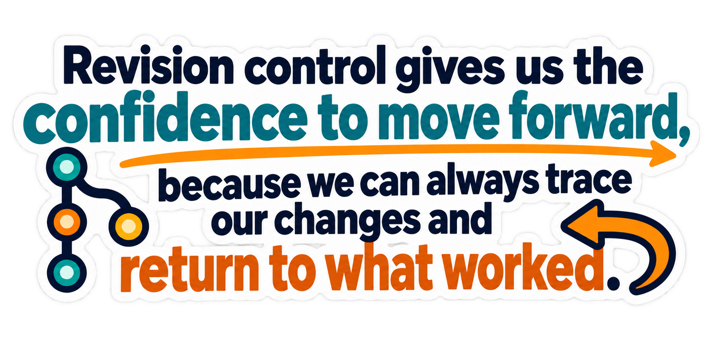

# 🐙 GitHub Assignment: Repository and README Practice

Assignment source: [cratchat/Git-Exercise](https://github.com/cratchat/Git-Exercise)

## 👤 1. Student Information

Name: Phurinat Chaikaow  
Email: phurinatch04@gmail.com

## 🖼️ 2. Picture

## 🎞️ 3. Animation

## 💬 4. Quote

Revision control gives us the confidence to move forward, because we can always trace our changes and return to what worked.

## 🎬 5. Video Lecture

[Video lecture](https://youtu.be/alfmHTYsEU4)
